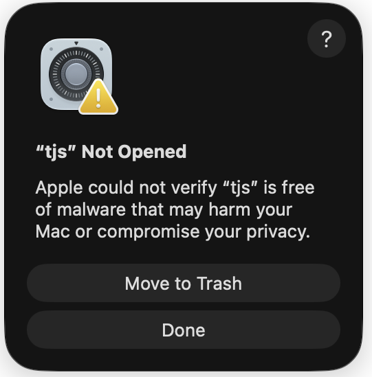
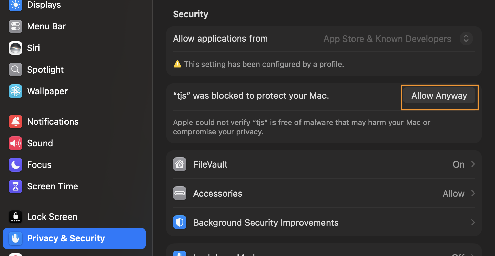

[简体中文](README.md) | [English](README.en.md)

# WordPing — Alfred translation and dictionary for Mac

**Look up a word, hear it, save it, and review it later, all from Alfred.**

> **⬇ [Download the latest WordPing](https://github.com/bitman-jpg/wordping-alfred/releases/latest)** · Requires Alfred 5.5+ with Powerpack and an Apple silicon Mac

- **No API key needed** — no Youdao developer account to register, it just works.
- **9 sources on one screen** — Youdao, iCiba, Baidu, Wiktionary, MyMemory, ECDICT, CC-CEDICT, system Oxford, and Apple Translation.
- **More than lookup** — press ⌃ Return to save a word, then review it with `wp :review` on a 1 / 3 / 7 / 14 / 30 / 60-day spaced schedule, including reverse review and due-word reminders.
- **Works offline too** — ECDICT, CC-CEDICT, and system Oxford work without a connection once downloaded; American, British, or both pronunciations.

**See it in 41 seconds:**

https://github.com/user-attachments/assets/b208655d-feaa-46a4-8ddd-1e5c57dc83f2

*Watch: explore multiple provider results and preview pages (41 seconds).*

## Compared with a typical Youdao-only workflow

|  | Typical Youdao-only workflow | WordPing |
| --- | --- | --- |
| API key required | Often yes | No |
| Sources compared on one screen | Youdao only | 9 sources |
| Save words | No | Yes |
| Spaced review | No | Yes (1 / 3 / 7 / 14 / 30 / 60 days) |
| Offline dictionaries | No | ECDICT, CC-CEDICT, system Oxford |

## Start in two minutes

1. Install the latest [WordPing workflow](https://github.com/bitman-jpg/wordping-alfred/releases/latest) in Alfred 5.5 or later with Powerpack. WordPing requires an Apple silicon Mac. Web lookups need an internet connection.
2. In the workflow setup, choose your **native language** and **learning language**, then choose **American**, **British**, or **Both** for online pronunciation. You can change these later in Alfred Preferences.
3. Open Alfred and type `wp hello` (or a word in your learning language). Press **Return** on a result to copy its full translation.
4. Press **⌃ Return** on a result you want to remember. Type `wp :review` to practice it.

If macOS says **Apple could not verify “tjs”**, dismiss the warning with **Done**. WordPing automatically opens **Privacy & Security** after a likely security block, once per bundled runtime. If it does not open, go to **System Settings → Privacy & Security**. Scroll down to **Security**, click **Open Anyway** for “tjs”, and confirm when prompted. Then retry `wp hello`. If **Open Anyway** is missing, try `wp hello` again before reopening Settings. Only approve a workflow downloaded from the official WordPing release page.

<table>
  <tr>
    <td valign="top"></td>
    <td valign="top"></td>
  </tr>
</table>

https://github.com/user-attachments/assets/1d244843-a647-483a-9f07-dd7ef6c483ba

*Watch: configure WordPing (14 seconds).*

## Look up a word or selected text

Type `wp ` followed by a word, phrase, or sentence. WordPing shows a row for each responding provider. Translation availability varies by language pair and provider.

https://github.com/user-attachments/assets/0a491372-d726-4364-9c34-8f7b99369a07

*Watch: find a word (10 seconds).*

To translate text in another Mac app, select it, then use WordPing's Alfred hotkey. To set up the demo's double-tap **⌥ Option** shortcut, open the workflow in Alfred Preferences, double-click **Hotkey Trigger**, set its hotkey to double-tap Option, and set **Argument** to **Selection in macOS**. If Alfred cannot read selected text, allow it in **System Settings → Privacy & Security → Accessibility**.

Use `wp` by itself to reopen a recent lookup. To erase recent lookups, type `wp :clear`.

## Explore results

The selected provider row has several useful actions:

| Keys | Action |
| --- | --- |
| **Return** | Copy the complete translation or meanings. |
| **⌘L** | Read a long result in Alfred's Large Type view. |
| **⌘ Return** | Hear the source word with a Mac voice. |
| **⌥ Return** | Hear online pronunciation; **Both** plays British, then American. |
| Hold **⌥ Option** | Show phonetics or pinyin where a dictionary provides them. |
| Hold **Shift** | Open a complete-entry preview when the selected source provides one. |

iCIBA uses a compatibility preview so its dictionary tabs can work in Quick Look. Collins definitions are retained when supplied; AI tabs depend on iCIBA's live responses, and unavailable content is labeled. Use the page's website link for the original page. **⌥ Return** on an iCIBA result plays iCIBA's recording in your configured accent; other providers use Youdao audio. If iCIBA has no recording for that accent, playback is unavailable.
| **⌃ Return** | Save the word for review. |

https://github.com/user-attachments/assets/b208655d-feaa-46a4-8ddd-1e5c57dc83f2

*Watch: explore multiple provider results and preview pages (41 seconds).*

Long translations are shortened in the result row, with a **⌘L** hint. **⌘L** opens the whole text; **Return** copies the whole text even when the row is shortened.

https://github.com/user-attachments/assets/4fd0375c-6b61-46b1-a19d-8b1c3799c46b

*Watch: read a complete translation (10 seconds).*

### Hear and read pronunciation

To hear the pronunciation in the demos below, click the player’s speaker icon to **unmute** the video.

**⌘ Return: Mac voice**

https://github.com/user-attachments/assets/b191c27a-92c3-4d1b-af0c-6f7128a0f524

**⌥ Return: Online audio** (British, then American when you choose **Both**)

https://github.com/user-attachments/assets/fe029d76-f937-4c53-827a-3d9470723b69

**Hold ⌥ Option: Show phonetics or pinyin**

https://github.com/user-attachments/assets/6b8fc2d0-d67a-4984-bf68-c6933692bd7e

Phonetics appear only on results whose dictionary supplies them. Online audio uses the pronunciation choice in the workflow setup.

## Choose a translation direction

WordPing normally uses your **native language** and **learning language** to choose a direction: text in your learning language goes to your native language, while text in your native language goes to your learning language. For other languages, it aims at your native language. For example, if your native language is Chinese and you are learning English, looking up the Chinese phrase “你说啥” produces English results, marked `zh→en` in this image.

To use another direction, such as **English directly to Korean**, prefix your query with `source>destination`: `wp en>ko awesome`. You can also type `wp es>zh trabajo` for Spanish to Simplified Chinese. `zh` means Simplified Chinese; `tw` or `zh-TW` means Traditional Chinese. A manual direction stays fixed even if a provider has no result.

## Build a word list

On a lookup result, press **⌃ Return** to save the word and its translation. Saving the same word again resets its review progress and makes it due now.

Type `wp :words` for the saved-word menu, or go directly to `wp :saved` to browse. Add text after `:saved` to search words **and** their translations. On a saved word, **⌃ Return** removes it permanently.

**Browse saved words:** `wp :saved`

https://github.com/user-attachments/assets/2eb44974-f001-41d5-91dc-ca06d14f2d2c

**Search words and translations:** `wp :saved text`

https://github.com/user-attachments/assets/40a15341-9836-4a47-9531-badf475ea13d

## Review in short sessions

Type `wp :review` to start or resume a session of up to 10 due words. Read the prompt, press **Return** to reveal the translation, then choose **Got it** or **Missed it**. **⌘ Return** speaks the word before you reveal it. A missed word comes back once at the end of that session. Your next reviews are scheduled after 1, 3, 7, 14, 30, and 60 days as you keep remembering a word.

This is a fixed-interval review schedule based on the Ebbinghaus forgetting curve.

https://github.com/user-attachments/assets/0dc6dc62-4e04-4a8f-a981-d7224f7ee651

*Watch: review saved words (21 seconds).*

To test recall the other way, type `wp :reverse`. You see the translation and try to remember the saved word. Type a space and your answer, then press **Return** on **Check**; you can accept or change the suggested grade. You can also press **Return** immediately to reveal the word and grade yourself. Both review directions share one schedule.

https://github.com/user-attachments/assets/6373069b-21b5-488e-8e45-259051ffa239

*Watch: reverse review (26 seconds).*

For a daily prompt, type `wp :remind 09:00` using any 24-hour local time. WordPing sends a notification only when words are due. Type `wp :remind` to see the schedule or turn it off.

https://github.com/user-attachments/assets/0113bbbb-82af-4a66-a4ce-e50864644901

*Watch: set a review reminder (17 seconds).*

## Keep or move your words

Type `wp :files` to see the three word-list actions:

| Command | What it creates or does |
| --- | --- |
| `wp :backup` | Save a complete backup in Downloads. It includes every saved word and your review progress. |
| `wp :restore` | Restore the backup from Downloads without removing words you already have. |
| `wp :export` | Save the current word list in Downloads for use in a spreadsheet. Review progress is not included. |

https://github.com/user-attachments/assets/83b68931-c1c7-4955-8cb7-286e9a068cb3

*Watch: open word management (6 seconds).*

## Updates and useful extras

Type `wp :update` to check GitHub Releases. If a newer version appears, press **Return** to download it and open Alfred's installation window. Your settings and saved words stay in Alfred's workflow data.

https://github.com/user-attachments/assets/da6b321b-c97d-4db4-8254-377ce1943fbc

*Watch: update WordPing (28 seconds).*

- If an English word is misspelled, choose a **Did you mean…?** suggestion and press **Tab** to retry the corrected word.
- Open `wp :` to discover commands without memorizing them.
- In Alfred's workflow configuration, choose which providers are enabled and how many recent lookups to keep. Some dictionaries only return results for single words.

### Optional Apple Translation

If you want an on-device Apple Translation result, use macOS 26 or newer and download both languages for the pair: **System Settings → General → Language & Region → Translation Languages**. WordPing uses installed languages only; it does not prompt to download them. If they are missing, that result is simply absent and the other providers can still respond.

### Local and downloadable dictionaries

The default provider order is **Oxford → ECDICT → CC-CEDICT → Apple → Youdao → iCiba → Baidu → Wiktionary → MyMemory**. You can reorder or remove sources in **Providers** in the Alfred workflow settings.

- **System Oxford (`oxford`)**: this usually works automatically when the Oxford dictionary is already available on your Mac. If no Oxford result appears, open macOS **Dictionary → Settings** and enable 牛津英汉汉英词典. Hold **Shift** on an Oxford result to read the complete entry in a large, scrollable preview.
- **ECDICT (`ecdict`)**: WordPing downloads this English–Chinese dictionary automatically on first use. Hold **Shift** on its result to read every available field in a scrollable preview. Open `wp :dictionaries` whenever you want to check for an update.
- **CC-CEDICT (`cedict`)**: WordPing installs this Chinese–English dictionary automatically alongside ECDICT. It includes traditional characters, simplified characters, and pinyin. Hold **Shift** to see every matching entry and definition. Update it from `wp :dictionaries`.

The first setup downloads about 63 MB for ECDICT and 4 MB for CC-CEDICT. To skip either download, remove its name from **Providers** before your first lookup. Once installed, both work offline and remain available after WordPing upgrades. If a newly installed dictionary does not appear in an older result, run `wp :clear` and look up the word again. For offline-only lookups, keep only `oxford,ecdict,cedict` in **Providers**.

## Privacy and data

WordPing sends lookup text to each enabled online provider. Oxford, Apple Translation, ECDICT, and CC-CEDICT work on your Mac after they are available. WordPing connects to the internet when it installs or updates ECDICT and CC-CEDICT. Recent lookups, downloaded dictionaries, saved words, and review progress stay on your Mac. Vocabulary backups contain your saved words and review progress, but no passwords or account details. Dictionary credits and licenses are in [THIRD_PARTY_DICTIONARIES.md](THIRD_PARTY_DICTIONARIES.md).

## Support WordPing

Questions, bug reports, and ideas are welcome in [GitHub Issues](https://github.com/bitman-jpg/wordping-alfred/issues).

If WordPing helps you, consider supporting its continued development.

Choose a payment method below. For WeChat Pay or Alipay, scan the corresponding QR code:

<table>
  <tr>
    <th>PayPal</th>
    <th>WeChat Pay</th>
    <th>Alipay</th>
  </tr>
  <tr>
    <td align="center">
      
    </td>
    <td></td>
    <td></td>
  </tr>
</table>

Thank you for supporting independent open source software.

## License

WordPing is available under the [MIT License](LICENSE).
