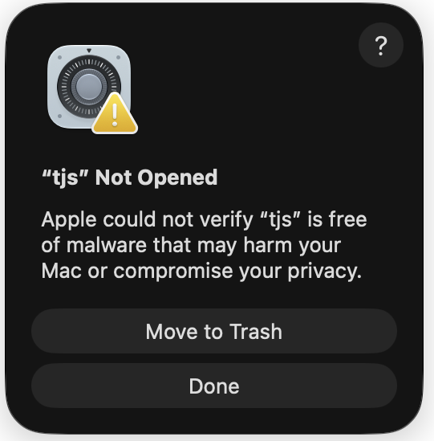
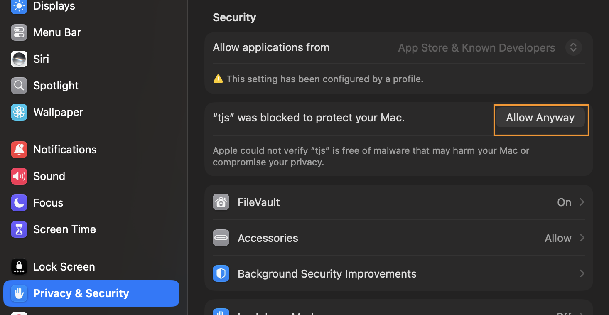

[简体中文](README.md) | [English](README.en.md)

# WordPing — Mac 上的 Alfred 翻译与词典工作流

**查词、听发音、收藏生词、间隔复习，都在 Alfred 里完成。**

> **⬇ [下载最新版 WordPing](https://github.com/bitman-jpg/wordping-alfred/releases/latest)** · 需要 Alfred 5.5+（Powerpack）与 Apple 芯片 Mac

- **无需申请 API 密钥** — 打开即用，不用注册有道开发者账号。
- **一屏对照 9 个来源** — 有道、爱词霸、百度、维基词典、MyMemory、ECDICT、CC-CEDICT、系统牛津、Apple 翻译。
- **不只是查词** — 按 ⌃ Return 收藏生词，用 `wp :review` 按 1 / 3 / 7 / 14 / 30 / 60 天间隔复习，还有反向复习和到期提醒。
- **离线也能查** — ECDICT、CC-CEDICT 与系统牛津下载后无需联网；可切换美音 / 英音发音。

**41 秒看它怎么工作：**

https://github.com/user-attachments/assets/b208655d-feaa-46a4-8ddd-1e5c57dc83f2

*演示：浏览多个来源的结果和预览页面（41 秒）。*

## 和常见的有道查词工作流比起来

|  | 常见的单来源有道工作流 | WordPing |
| --- | --- | --- |
| 需要申请 API 密钥 | 往往需要 | 不需要 |
| 一屏对照多个来源 | 只有有道 | 9 个来源 |
| 收藏生词 | 没有 | 有 |
| 间隔复习 | 没有 | 有（1 / 3 / 7 / 14 / 30 / 60 天） |
| 离线词典 | 没有 | ECDICT、CC-CEDICT、系统牛津 |

## 两分钟上手

1. 从 [GitHub Releases 下载最新版 WordPing 工作流](https://github.com/bitman-jpg/wordping-alfred/releases/latest)，用 Alfred 5.5 或更新版本打开。需要 Powerpack 和 Apple 芯片 Mac；在线查询需要联网。
2. 首次安装时，选择**母语**和**学习语言**，再选择在线发音的**美音**、**英音**或**两者**。之后可以在 Alfred 设置中修改。
3. 打开 Alfred，输入 `wp hello`（也可以换成正在学习的词）。选中结果后按 **Return**，即可复制完整译文。
4. 遇到想记住的词，在结果上按 **⌃ Return** 收藏。输入 `wp :review` 开始复习。

如果 macOS 提示 **Apple 无法验证“tjs”是否包含恶意软件**，请点击**完成**关闭提示。WordPing 检测到可能的安全拦截后，会自动打开**隐私与安全性**（同一个运行程序仅自动打开一次）。如果设置未打开，请前往**系统设置 → 隐私与安全性**。向下滚动到**安全性**，为“tjs”点击**仍要打开**并按提示确认，然后重试 `wp hello`。如果没有看到**仍要打开**，请先再次运行 `wp hello`，再重新打开设置。仅批准从 WordPing 官方发布页下载的工作流。

<table>
  <tr>
    <td valign="top"></td>
    <td valign="top"></td>
  </tr>
</table>

https://github.com/user-attachments/assets/1d244843-a647-483a-9f07-dd7ef6c483ba

*演示：设置 WordPing（14 秒）。*

## 查词与翻译选中的文字

输入 `wp `，再输入单词、短语或句子。每个有结果的翻译来源会显示一行。可用结果取决于语言组合及翻译来源。

https://github.com/user-attachments/assets/0a491372-d726-4364-9c34-8f7b99369a07

*演示：查找单词（10 秒）。*

若要翻译其他 Mac 应用中的文字，先选中文字，再使用 WordPing 的 Alfred 快捷键。要设置演示中的**连按两次 ⌥ Option**：在 Alfred 设置中打开 WordPing，双击 **Hotkey Trigger**，将快捷键设为连按两次 Option，并将 **Argument** 设为 **Selection in macOS**。如果 Alfred 无法读取选中的文字，请在**系统设置 → 隐私与安全性 → 辅助功能**中允许 Alfred。

只输入 `wp` 可重新打开最近查过的内容。输入 `wp :clear` 可清除查询历史。

## 查询结果的更多操作

选中某个来源的结果后，可以使用这些按键：

| 按键 | 操作 |
| --- | --- |
| **Return** | 复制完整译文或释义。 |
| **⌘L** | 在 Alfred 的大字视图中阅读较长的译文。 |
| **⌘ Return** | 用 Mac 系统语音朗读原词。 |
| **⌥ Return** | 播放在线发音；若选择“两者”，会先播放英音，再播放美音。 |
| 按住 **⌥ Option** | 词典提供音标或拼音时，显示这些信息。 |
| 按住 **Shift** | 在所选来源支持时，预览完整词条。 |

爱词霸使用兼容预览，支持在 Quick Look 中切换词典；页面提供的柯林斯释义会保留，AI 内容取决于爱词霸的在线响应，未提供的内容会明确提示。点击页面中的网站链接可查看原网页。选中爱词霸结果时，**⌥ Return** 播放爱词霸提供的对应口音录音；其他来源使用有道发音。若爱词霸没有该口音的录音，则无法播放。
| **⌃ Return** | 收藏这个词，供日后复习。 |

https://github.com/user-attachments/assets/b208655d-feaa-46a4-8ddd-1e5c57dc83f2

*演示：浏览多个来源的结果和预览页面（41 秒）。*

较长的译文会在结果行中缩写，并显示 **⌘L** 提示。按 **⌘L** 查看全文；即使结果行被缩写，按 **Return** 仍会复制全文。

https://github.com/user-attachments/assets/4fd0375c-6b61-46b1-a19d-8b1c3799c46b

*演示：阅读完整译文（10 秒）。*

### 听发音、看音标

播放下面的发音演示时，请点击播放器的扬声器图标**取消静音**，才能听到视频里的发音。

**⌘ Return：Mac 系统语音**

https://github.com/user-attachments/assets/b191c27a-92c3-4d1b-af0c-6f7128a0f524

**⌥ Return：在线发音**（选择“两者”时先播放英音，再播放美音）

https://github.com/user-attachments/assets/fe029d76-f937-4c53-827a-3d9470723b69

**按住 ⌥ Option：查看音标或拼音**

https://github.com/user-attachments/assets/6b8fc2d0-d67a-4984-bf68-c6933692bd7e

只有词典提供音标时才会显示。在线发音会使用你在工作流设置中选择的口音。

## 选择翻译方向

WordPing 默认根据你设置的**母语**和**学习语言**选择方向：输入学习语言时译成母语，输入母语时译成学习语言；输入其他语言时尽量译成母语。例如，母语设为中文、学习语言设为英语时，查询中文“你说啥”会得到英语结果，图中标为 `zh→en`。

如果想使用不同于默认设置的方向，例如**直接把英语译成韩语**，就在查询文字前加 `来源语言>目标语言`：`wp en>ko awesome`。也可以输入 `wp es>zh trabajo`，把西班牙语译成简体中文。`zh` 表示简体中文，`tw` 或 `zh-TW` 表示繁体中文。手动指定后，即使某个来源没有结果，WordPing 也不会自动反转方向。

## 建立自己的单词本

在查询结果上按 **⌃ Return**，收藏单词和译文。再次收藏同一个词会重置复习进度，并让它立即进入待复习列表。

输入 `wp :words` 打开单词本菜单，或直接输入 `wp :saved` 浏览。接着输入文字，即可同时搜索单词和译文。在已收藏的词上按 **⌃ Return**，会永久删除该词。

**浏览已收藏单词：** `wp :saved`

https://github.com/user-attachments/assets/2eb44974-f001-41d5-91dc-ca06d14f2d2c

**搜索单词和译文：** `wp :saved 关键词`

https://github.com/user-attachments/assets/40a15341-9836-4a47-9531-badf475ea13d

## 利用几分钟复习

输入 `wp :review`，开始或继续复习，每轮最多 10 个到期的词。先回想词义，再按 **Return** 显示译文，然后选择 **Got it**（记住了）或 **Missed it**（没记住）。揭晓前可按 **⌘ Return** 听发音。本轮答错的词会在轮末再出现一次。连续记住时，之后的复习间隔依次为 1、3、7、14、30、60 天。

这是一套基于艾宾浩斯遗忘规律的固定间隔复习计划。

https://github.com/user-attachments/assets/0dc6dc62-4e04-4a8f-a981-d7224f7ee651

*演示：复习单词（21 秒）。*

想从译文反过来回忆原词，输入 `wp :reverse`。看到译文后，输入一个空格和你的答案，再在 **Check** 上按 **Return**；你可以接受或修改建议的评分。也可以直接按 **Return** 显示原词，自行评分。正向和反向复习共用同一套复习计划。

https://github.com/user-attachments/assets/6373069b-21b5-488e-8e45-259051ffa239

*演示：反向复习（26 秒）。*

想每天收到提醒，输入 `wp :remind 09:00`；时间采用本地 24 小时制。只有单词到期时，WordPing 才会发送通知。输入 `wp :remind` 可查看或关闭提醒。

https://github.com/user-attachments/assets/0113bbbb-82af-4a66-a4ce-e50864644901

*演示：设置复习提醒（17 秒）。*

## 备份和导出单词

输入 `wp :files`，可以看到三个单词本操作：

| 命令 | 作用 |
| --- | --- |
| `wp :backup` | 在“下载”文件夹保存完整备份，包含所有收藏单词和复习进度。 |
| `wp :restore` | 从“下载”文件夹恢复备份，不会删除已有单词。 |
| `wp :export` | 在“下载”文件夹保存当前单词列表，可用表格软件打开；不包含复习进度。 |

https://github.com/user-attachments/assets/83b68931-c1c7-4955-8cb7-286e9a068cb3

*演示：打开单词管理菜单（6 秒）。*

## 更新与其他实用功能

输入 `wp :update` 检查 GitHub Releases。如果有新版本，按 **Return** 下载并打开 Alfred 的安装窗口。工作流设置和已收藏单词会保留在 Alfred 的数据目录中。

https://github.com/user-attachments/assets/da6b321b-c97d-4db4-8254-377ce1943fbc

*演示：更新 WordPing（28 秒）。*

- 英文单词拼错时，可选中 **Did you mean…?** 建议，按 **Tab** 改用正确拼写查询。
- 输入 `wp :`，可直接查看可用命令，不必记住每个命令。
- 在 Alfred 的工作流设置中，可选择启用哪些翻译来源，以及保留多少条最近查询。有些词典只支持单个词。

### 可选的 Apple 翻译

若想使用设备端的 Apple 翻译结果，需要 macOS 26 或更新版本，并在**系统设置 → 通用 → 语言与地区 → 翻译语言**中下载这两个语言。WordPing 只使用已安装的语言，不会弹出下载提示。如果尚未安装，对应的 Apple 结果不会显示，其他来源仍可返回结果。

### 本地及可下载词典

默认来源顺序为 **Oxford → ECDICT → CC-CEDICT → Apple → Youdao → iCiba → Baidu → Wiktionary → MyMemory**。可在 Alfred 的 WordPing 设置中通过 **Providers** 调整顺序或移除来源。

- **系统牛津（`oxford`）**：如果 Mac 已有牛津词典，通常无需设置即可使用。若没有牛津结果，请打开 macOS **词典 App → 设置**，启用“牛津英汉汉英词典”。在牛津结果上按住 **Shift**，可在大型、可滚动的预览中查看完整词条。
- **ECDICT（`ecdict`）**：首次使用时，WordPing 会自动下载这本英汉词典。在结果上按住 **Shift**，可在可滚动的预览中查看词典提供的所有字段。以后可打开 `wp :dictionaries` 检查更新。
- **CC-CEDICT（`cedict`）**：WordPing 会与 ECDICT 一同自动安装这本汉英词典，支持繁体、简体和拼音。按住 **Shift** 可查看所有匹配词条和释义；可通过 `wp :dictionaries` 更新。

首次设置会下载约 63 MB 的 ECDICT 和约 4 MB 的 CC-CEDICT。若不想下载其中一本，请在首次查询前从 **Providers** 移除它。安装完成后，两本词典都可离线使用，升级 WordPing 也不会丢失。若新安装的词典没有出现在旧结果中，请运行 `wp :clear` 后重新查询。若只想离线查词，可在 **Providers** 中仅保留 `oxford,ecdict,cedict`。

## 隐私与数据

WordPing 会把查询文字发送给已启用的在线来源。牛津、Apple 翻译、ECDICT 和 CC-CEDICT 准备好后会在 Mac 上运行。安装或更新 ECDICT、CC-CEDICT 时需要联网。最近查询、下载的词典、已收藏单词和复习进度都保存在 Mac 上。词汇备份包含收藏单词和复习进度，不包含密码或账号信息。词典署名和许可见 [THIRD_PARTY_DICTIONARIES.md](THIRD_PARTY_DICTIONARIES.md)。

## 支持 WordPing

欢迎在 [GitHub Issues](https://github.com/bitman-jpg/wordping-alfred/issues) 提问、报告问题或提出改进建议。

如果 WordPing 对你有帮助，可以考虑支持后续开发。选择以下方式；微信支付或支付宝可扫描二维码：

<table>
  <tr>
    <th>PayPal</th>
    <th>微信支付</th>
    <th>支付宝</th>
  </tr>
  <tr>
    <td align="center">
      
    </td>
    <td></td>
    <td></td>
  </tr>
</table>

感谢你支持独立开源项目。

## 许可证

WordPing 采用 [MIT 许可证](LICENSE)。
